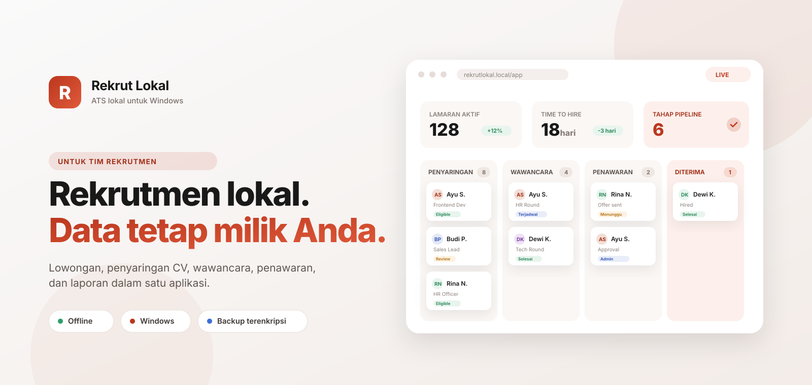
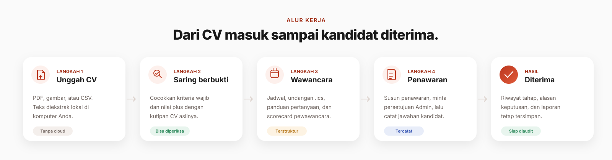

<div align="center">



# Rekrut Lokal

**ATS lokal untuk tim rekrutmen Indonesia.** Kelola lowongan, kandidat, penyaringan CV,
wawancara, penawaran, dan laporan dari satu aplikasi di komputer Anda sendiri.

Data tetap milik Anda. Tidak ada langganan per pengguna. Tetap jalan tanpa internet.

[](../../releases/latest)
[](#coba-gratis-7-hari)
[](https://wa.me/6285111870462?text=Halo%2C%20saya%20ingin%20tanya%20Rekrut%20Lokal)
[](#pembaruan-dan-rilis)

</div>

---

## Kenapa Rekrut Lokal

Kebanyakan ATS modern bagus, tetapi mahal, berbasis cloud, dan menagih per pengguna.
Untuk perusahaan 10–200 karyawan dan biro rekrutmen kecil, itu berarti data kandidat
keluar dari kantor dan biaya naik setiap kali tim bertambah.

Rekrut Lokal mengambil arah sebaliknya:

|                   | Rekrut Lokal                                  | ATS cloud biasa                |
| ----------------- | --------------------------------------------- | ------------------------------ |
| **Data kandidat** | Tetap di komputer Anda                        | Tersimpan di server vendor     |
| **Biaya**         | Lisensi tahunan per instalasi                 | Langganan per pengguna         |
| **Internet**      | Hanya saat setup dan bila memakai AI          | Wajib selalu tersambung        |
| **Anggaran AI**   | Kunci Gemini pribadi, opsional                | Biasanya dibundel dan dibatasi |
| **Backup**        | Terenkripsi `.age`, Anda pegang kata sandinya | Mengikuti kebijakan vendor     |

## Fitur

<div align="center">
  
</div>

### Dari lowongan sampai penawaran

- **Lowongan dan kriteria** — simpan kriteria wajib dan nilai plus, lengkap dengan
  requisisi, departemen, jumlah kebutuhan, gaji, dan anggaran.
- **Pipeline per lowongan** — atur tahap sendiri, urutkan, dan pasang follow-up otomatis.
- **Penyaringan berbukti** — cocokkan teks CV dengan kriteria dan tampilkan kutipan
  buktinya. Hasil yang belum yakin ditandai untuk diperiksa manusia.
- **Wawancara dan scorecard** — jadwal, undangan `.ics`, penilaian enam kompetensi,
  dan panduan wawancara dari kriteria lowongan.
- **Penawaran kerja** — susun, ajukan persetujuan Admin, kirim, lalu catat jawaban.
- **Komunikasi** — catat WhatsApp/email dan tindak lanjut agar riwayat tidak hilang.

### Kandidat dan laporan

- **Talent pool lintas lowongan** — tag, catatan, consent, dan keputusan penyimpanan.
- **Laporan** — time-to-hire, konversi antar tahap, efektivitas sumber kandidat, tren
  bulanan, dan pemeriksaan konsistensi keputusan. Semua bisa diekspor ke CSV.

### Lokal, aman, dan terkendali

- **Data di komputer sendiri** — database, CV, dan riwayat tersimpan di folder aplikasi.
- **Backup terenkripsi** — otomatis dan manual, dengan kata sandi yang hanya Anda pegang.
- **Peran Admin, Recruiter, Viewer** — akses berbeda, setiap perubahan penting masuk audit.
- **Mode LAN** — pakai bersama tim di jaringan kantor tanpa server cloud.
- **Citra, asisten AI opsional** — kunci Gemini pribadi tiap pengguna; tanpa AI aplikasi
  tetap berjalan penuh.
- **Lisensi offline** — diverifikasi tanpa menghubungi server lisensi.

## Untuk siapa

- **HRD perusahaan kecil dan menengah** yang ingin berhenti memakai spreadsheet.
- **Biro rekrutmen dan konsultan HR** yang mengelola banyak lowongan untuk beberapa klien.
- **Tim yang peduli privasi** dan ingin data kandidat tetap di kantor.
- **Kantor dengan internet tidak stabil** yang tetap butuh sistem rekrutmen utuh.

## Harga

**Lisensi tahunan per instalasi. Pengguna lokal tidak dibatasi, tanpa biaya per akun.**

- Setiap instalasi bisa dipakai seluruh tim: Admin, Recruiter, dan Viewer tanpa batas.
- Termasuk pembaruan versi dan dukungan WhatsApp/email selama masa lisensi.
- **Coba gratis 7 hari** — tanpa kartu kredit, tanpa komitmen.
- Harga menyesuaikan jumlah instalasi dan kebutuhan dukungan.

**Cara membeli atau minta demo:**

1. Chat WhatsApp Business
   **[+62 851-1187-0462](https://wa.me/6285111870462?text=Halo%2C%20saya%20ingin%20tanya%20Rekrut%20Lokal)**
   atau kirim email ke
   **[lihenzar@gmail.com](mailto:lihenzar@gmail.com?subject=Tanya%20Rekrut%20Lokal)**.
2. Sebutkan jumlah instalasi dan kebutuhan tim Anda.
3. Kami kirim penawaran resmi; kunci lisensi diterbitkan setelah pembayaran dikonfirmasi.

Balasan dalam **1 hari kerja**. Untuk demo atau migrasi dari spreadsheet, tulis di pesan
pertama.

## Coba gratis 7 hari

Setelah setup, buka halaman **Aktivasi** dan tempel kunci trial universal ini:

```
RL1.eyJ2IjoxLCJpZCI6ImxpY180ZjYzYTU0OWFhN2FkNzk4IiwibGljZW5zZWUiOiJUcmlhbCBVbml2ZXJzYWwiLCJtYWNoaW5lIjoiKiIsInBsYW4iOiJ0cmlhbCIsImlzc3VlZEF0IjoiMjAyNi0xMS0wN1QwNTowMTo0MS40NDRaIiwiZXhwaXJlc0F0IjoiMjAyNy0xMS0wN1QwNTowMTo0MS40NDRaIiwidHJpYWxEYXlzIjo3LCJub3RlIjoiVHJpYWwgdW5pdmVyc2FsIDcgaGFyaSBzZWphayBha3RpdmFzaSJ9.Il2Vdoq8vmwr_YqKFRrPVvJSzlVhSaZkcRXtvSpeTIh9SD3oaPVLgeukuDSG45vEYSJx9kvFkMUKkGYWuBa7Bg
```

Masa trial **7 hari dihitung sejak kunci pertama kali diaktifkan** di komputer itu, bukan
sejak kunci diterbitkan. Kunci ini bisa dipakai di komputer mana pun dan masih bisa
diaktifkan sampai **7 November 2027**. Setelah trial habis, aplikasi kembali ke halaman
Aktivasi.

> Gunakan versi **0.2.3 atau lebih baru**. Versi lama menghitung masa trial dari tanggal
> kunci diterbitkan.

## Unduh dan pasang

1. Buka tab **[Releases](../../releases/latest)** dan pilih versi terbaru.
2. Unduh `RekrutLokal-Setup-vX.Y.Z.exe`.
3. Jalankan installer, lalu buka **RekrutLokal** dari Start Menu.
4. Pilih **Setup awal**, tunggu sampai selesai, lalu catat **Kode mesin**.
5. Aktifkan lisensi, buat Admin pertama, lalu tambahkan pengguna lain.

**Persyaratan:** Windows 10/11 64-bit. Installer sudah membawa Node.js 22, jadi tidak
perlu memasang Node manual. Setup pertama membutuhkan internet untuk memasang komponen.

## Pembaruan dan rilis

Versi memakai format `vX.Y.Z`. Setiap rilis menerbitkan tiga berkas:

| Berkas                               | Isi                                       |
| ------------------------------------ | ----------------------------------------- |
| `RekrutLokal-Setup-vX.Y.Z.exe`       | Installer Windows, sudah termasuk Node.js |
| `RekrutLokal-Client-vX.Y.Z.zip`      | Paket aplikasi untuk pemasangan manual    |
| `RekrutLokal-Client-vX.Y.Z-full.zip` | Paket aplikasi plus Node.js portable      |

Cara memperbarui:

1. Tutup aplikasi dari launcher (**Hentikan Aplikasi**).
2. Buka **RekrutLokal.exe**, pilih **Update**.
3. Aplikasi mengunduh paket Client dari rilis terbaru di repositori ini, memasang
   dependensi, lalu membangun ulang aplikasi.
4. Setelah selesai, pilih **Jalankan Aplikasi**.

Yang selalu dipertahankan: `.data` (database, CV, lisensi, pengaturan), `.env.local`, dan
folder `runtime`. Bila versi terpasang sudah sama, updater berhenti tanpa mengubah berkas.
Tidak perlu akun atau token GitHub.

Jika update otomatis gagal, unduh installer versi terbaru dan pasang di folder yang sama.
**Jangan menghapus `.data`**; data dan lisensi ada di sana.

## Pertanyaan yang sering diajukan

**Apakah data kandidat dikirim ke cloud?**
Tidak. Database, CV, dan riwayat tersimpan di folder aplikasi. Hanya fitur AI opsional yang
mengirim potongan teks ke Gemini, dan Admin bisa mematikannya.

**Apakah harus selalu online?**
Tidak. Internet dibutuhkan saat setup pertama dan saat memakai AI. Fitur inti berjalan
offline.

**Bisa dipakai beberapa orang sekaligus?**
Bisa. Setiap orang punya akun dengan peran sendiri, dan mode LAN membuka aplikasi untuk
komputer lain di jaringan kantor.

**Bagaimana kalau komputer rusak?**
Pulihkan dari backup `.age` terbaru. Backup berisi database, CV, dan pengaturan; kata sandi
hanya Anda yang pegang.

**Apakah lisensi bisa dipindah ke komputer baru?**
Bisa. Lisensi terikat kode mesin, jadi minta penerbitan ulang untuk komputer baru.

**Apakah installer ini resmi?**
Ya, berkas diunduh dari repositori rilis ini. Installer belum ditandatangani digital, jadi
Windows SmartScreen bisa menampilkan peringatan. Pilih **More info → Run anyway** hanya jika
berkas berasal dari halaman ini.

## Bantuan

- Port dipakai aplikasi lain: tutup aplikasi tersebut lalu jalankan lagi.
- Antivirus memblokir: izinkan folder aplikasi dan Node.js.
- Masalah lain: kirim log terbaru dari `.data/logs` dan salinan diagnostik dari halaman error.

---

<div align="center">

**Rekrut Lokal** · dibuat untuk tim rekrutmen yang ingin datanya tetap di tangan sendiri.

Copyright (c) 2026 LiHenZ. Hak cipta dilindungi.

</div>
